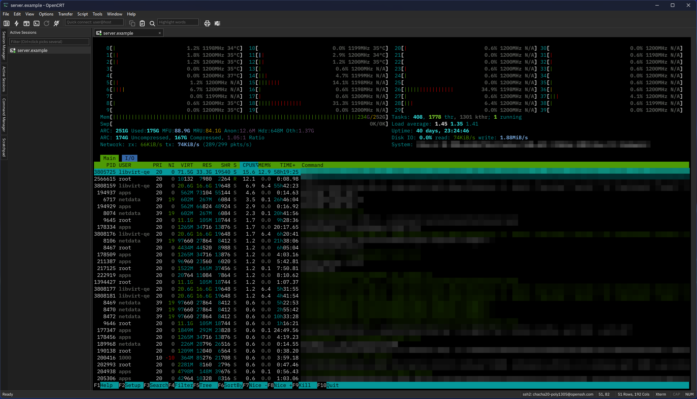

# OpenCRT

A tabbed terminal client for Windows, macOS and Linux, modelled on the look and
workflow of SecureCRT and written from scratch in Rust.



## A clean-room implementation
OpenCRT is an independent project. It is not affiliated with, endorsed by or
derived from VanDyke Software or its SecureCRT product. No SecureCRT source
code, binaries, decompiled or disassembled code, or other copyrighted material
was used to build it. OpenCRT was written from the ground up, with feature
parity as the goal: SecureCRT's features and behaviour were learned only from
its public documentation and from using the product, and every line of
OpenCRT is original. SecureCRT is a trademark of VanDyke Software, Inc.

## Download
Installers for each release are on the
[Releases](https://github.com/KimP0ssible-no/OpenCRT/releases) page (Windows
files are signed as the [Code signing policy](#code-signing-policy) describes):

| Platform | Package |
| --- | --- |
| Windows 10/11 (x64) | `opencrt-<version>-x64-setup.exe`, or the `.msi` for unattended and Group Policy installs |
| Windows, portable (x64) | `opencrt-<version>-x64-portable.zip`: unpack anywhere (a USB stick), nothing installed |
| macOS (Apple silicon and Intel) | `OpenCRT.dmg` |
| Debian / Ubuntu | `opencrt_<version>-1_amd64.deb` |
| RHEL / Rocky / Alma / Fedora / SUSE | `opencrt-<version>-1.x86_64.rpm` |
| Arch Linux | `opencrt-<version>-1-x86_64.pkg.tar.zst` |

The Linux packages need nothing beyond glibc 2.28 (RHEL 8, Debian 10, Ubuntu
20.04 and newer). `SHA256SUMS` lists the checksum of every file.

The portable zip carries a `portable.txt` beside `opencrt.exe`: while it is
there, OpenCRT keeps its settings, sessions and host keys in a `settings`
folder next to the program and nothing in the Windows profile. Saved passwords
are kept only under a master password (Tools > Master Password), encrypted in
that folder. The same file works next to any OpenCRT program, on any system.

### Mac users: install how-to
OpenCRT is not notarised by Apple yet. Install it from Terminal
(Applications > Utilities > Terminal) with:

```sh
curl -fsSL https://raw.githubusercontent.com/KimP0ssible-no/OpenCRT/main/packaging/macos/install.sh | sh
```

[The script](packaging/macos/install.sh) downloads `OpenCRT.dmg` from the
latest release, checks it against `SHA256SUMS`, puts OpenCRT in Applications
(in your own `~/Applications` if you cannot write to the shared one) and starts
it. A file Terminal downloads is not flagged as downloaded from the internet,
so macOS opens OpenCRT without asking.

**Upgrades** need nothing more: OpenCRT looks for a new version at start-up and
once a day (Help > Check for Updates to look now), and **Update
Now** downloads it, checks the release signature, replaces the app and restarts
it. Running the install command again also upgrades (quit OpenCRT first).

**From the disk image instead**: open `OpenCRT.dmg` and drag OpenCRT onto
Applications. The first double-click ends with "OpenCRT Not Opened": click
**Done**, then in **System Settings > Privacy & Security** click **Open
Anyway**, confirm, and enter your password or use Touch ID (right-click > Open
no longer does this on macOS 15 and later).

**Local network**: the first connection to a host on your local network makes
macOS ask whether OpenCRT may use it: click **Allow**. If you did not,
connections fail with "No route to host"; turn OpenCRT on in **System Settings
> Privacy & Security > Local Network**.

### Linux package repositories
On Linux, add the signed OpenCRT repository for your distribution once, and
OpenCRT then updates with the rest of the system (a downloaded package installs
the same way but does not update). The setup for each distribution is at
**[kimp0ssible-no.github.io/OpenCRT](https://kimp0ssible-no.github.io/OpenCRT/)**;
the packages are signed with key `4CDBBCAD19D8BFC8FB62281A3576977C76DF7C33`.

Debian, Ubuntu:
```
sudo install -d /etc/apt/keyrings
curl -fsSL https://kimp0ssible-no.github.io/OpenCRT/opencrt.asc | sudo tee /etc/apt/keyrings/opencrt.asc > /dev/null
echo "deb [signed-by=/etc/apt/keyrings/opencrt.asc] https://kimp0ssible-no.github.io/OpenCRT/apt stable main" | sudo tee /etc/apt/sources.list.d/opencrt.list
sudo apt update && sudo apt install opencrt
```

Fedora, RHEL, Rocky, Alma:
```
sudo curl -fsSL -o /etc/yum.repos.d/opencrt.repo https://kimp0ssible-no.github.io/OpenCRT/rpm/opencrt.repo
sudo dnf install opencrt
```

openSUSE:
```
sudo zypper addrepo https://kimp0ssible-no.github.io/OpenCRT/rpm/opencrt.repo
sudo zypper install opencrt
```

Arch Linux:
```
curl -fsSL https://kimp0ssible-no.github.io/OpenCRT/opencrt.asc | sudo pacman-key --add -
sudo pacman-key --lsign-key 4CDBBCAD19D8BFC8FB62281A3576977C76DF7C33
printf '\n[opencrt]\nServer = https://kimp0ssible-no.github.io/OpenCRT/arch\n' | sudo tee -a /etc/pacman.conf
sudo pacman -Syu opencrt
```

### Verifying a download
`SHA256SUMS` is signed with the OpenCRT release key
([`packaging/minisign.pub`](packaging/minisign.pub)), and every file has a
GitHub build attestation tying it to the workflow run that built it:

```
minisign -Vm SHA256SUMS -p minisign.pub       # the list is genuine
sha256sum -c --ignore-missing SHA256SUMS      # the files match it
gh attestation verify <file> --repo KimP0ssible-no/OpenCRT
```

### New versions
At start-up, and once a day while it runs, OpenCRT asks GitHub which release
is the newest (one request to `github.com/KimP0ssible-no/OpenCRT/releases/latest`,
nothing about you or your sessions is sent) and says so in the status bar when
there is a newer one. Help > Check for Updates asks at any time; turn the
automatic check off in Options > Global Options > General.

## Features
- **Protocols**: SSH2 (password, keyboard-interactive, public key incl. PuTTY
  PPK, with passphrase prompts, and SSH agent keys — Pageant or the OpenSSH
  agent on Windows, `SSH_AUTH_SOCK` elsewhere — when no key file is set),
  Telnet, RLogin, raw TCP, serial (COM / tty, modem dialling, VM consoles),
  local shell (on Windows PowerShell, Command Prompt or a WSL distribution from
  the toolbar's local-shell button), and RDP (remote desktop
  in a tab that follows the tab's size, keyboard and mouse, clipboard text
  both ways; NLA with user name and password; the console (administrative)
  session like `mstsc /admin`), and VNC (RFB 3.3 to 3.8: no
  password, a VNC password, TightVNC's login, a Mac's own account, or
  VeNCrypt TLS with a certificate checked like RDP's; Tight with JPEG
  quality for slow links, ZRLE; the desktop is shown whole or scaled to the
  tab; without VeNCrypt, set a jump host to tunnel it over SSH).
- **Security**: host keys checked against OpenCRT's own `known_hosts`; unknown
  keys are confirmed by the user (or, if Global Options > Connection says so,
  saved without asking, as OpenSSH's `accept-new`), changed keys block the
  connection; saved keys
  can be reviewed and removed in Tools > Host Keys. RDP server certificates
  are checked the same way (`rdp_known_certs`) before any password is sent.
  Saved passwords and key passphrases live in the system keychain, or, with a
  master password (Tools > Master Password), in the settings folder encrypted
  (Argon2id, AES-256-GCM), entered once per run when first needed and carried
  by Settings Sync.
- **Terminal**: xterm emulation (256 colours, truecolour, mouse reporting,
  bracketed paste), scrollback with Find, selection and copy (optionally copy
  on select, paste on right- or middle-click, ask before multi-line pastes),
  twenty colour schemes (OpenCRT Dark by default; Solarized, Gruvbox, Dracula,
  Nord, Tomorrow, One Dark, Catppuccin, Tango, Tokyo Night and more), IBM Plex
  Mono built in or a system font, cursor shape, light and dark window themes that follow the
  system, an interface font size for menus, tabs and dialogs (on Linux it starts at the desktop's), CJK text, bell as flash or sound, plain-text session
  logging with optional timestamps and dated file names that roll over at
  midnight (per session or File > Log Session), a raw log beside it with the
  bytes as received (`.raw`, for emulation debugging), recordings in asciicast
  v2 (File > Record Session, for `asciinema play` and web players), Send
  Break for serial and Telnet, per-session terminal type, Latin-1 encoding
  and Backspace as ^H, function-key mapping, full screen and always on top.
- **Sessions**: Session Manager with folders (rename, Connect All, drag and drop), filter
  (Enter connects) and duplicate; Session Options incl. a tab colour per
  session; a Default Session that new sessions, Quick Connect and the
  connect bar start from; connect bar (`user@host`); tabs with
  reconnect/clone/move (an SSH2 clone or SFTP tab reuses the tab's
  connection, no second login); automatic reconnect; reopening last time's
  sessions; SSH keepalive and per-session anti-idle; Global Options, Button
  Bar, Command Manager (with folders), Command Window, keyword
  highlighting (any colour on the background or the text, bold, whole words,
  whole lines, regular expressions),
  Edit > Send Input to All Tabs; import from `~/.ssh/config`,
  from SecureCRT (sessions with their button bar and keyword list, the button
  bars' send and run-script buttons, and keyword lists with their exact
  colours and regular expressions, older Keyword List V2 files too),
  export/import of sessions, and Remote Desktop Connection `.rdp` files as RDP
  sessions (Tools > Import Sessions, several at once).
- **Settings Sync**: keep sessions, options, host keys and scripts in a
  private git repository (GitHub, GitLab or your own server; HTTPS with a
  token or SSH with a key or agent) shared by all your computers on any OS.
  Changes are merged by content; passwords and machine-specific settings stay
  on each computer. Uses the installed `git` (a dependency of the Linux
  packages; on Windows OpenCRT offers to download Git for Windows).
- **Automation**: [Rhai](https://rhai.rs) scripts (`.rhai`, see Scripting
  below), SecureCRT's Python scripts (`.py`, unchanged) and simple
  `wait` / `send` / `sleep` / `timeout` scripts, run from
  Script > Run or as a session's logon script; Script > Start Recording writes
  a Rhai script from what you type (passwords are asked for when it runs).
  Scripts kept in the `scripts` folder in the settings folder (where Script >
  Run starts) go wherever Settings Sync takes your settings; a logon script
  in there is saved by its name, so every computer finds it.
- **Keys**: Tools > Create Public Key makes an Ed25519 key pair.
- **File transfer**: SFTP tab (`sftp>` prompt with get/put/ls/cd, wildcards and
  progress) or SFTP GUI tab (local and remote file lists side by side, with a
  queue of waiting, failed and finished transfers; folders copy whole); Zmodem downloads start when the host runs `sz` (saved to
  Downloads or the folder set in Global Options), uploads via Transfer >
  Zmodem Upload or when the host runs `rz`; Xmodem and Ymodem send and
  receive; drop a file on a tab to upload it; a built-in TFTP server for
  network devices (Global Options > File Transfer).
- **SSH port forwarding**: local, remote and dynamic (SOCKS4/5); jump hosts
  (connect through a gateway, set per session); SOCKS5 or HTTP proxies (SSH2,
  Telnet, raw); agent and X11 forwarding; optional compression;
  legacy algorithms for old devices, per session or for every host (Global
  Options > Connection).

## Keyboard
| Keys | Action |
| --- | --- |
| Ctrl+C / Ctrl+V | Copy (when text is selected, else ^C to the host) / paste |
| Ctrl+Insert / Shift+Insert | Copy / paste |
| Shift+PgUp / Shift+PgDn | Scroll back / forward |
| Ctrl+Tab / Ctrl+Shift+Tab | Next / previous tab |
| Ctrl+Shift+T (Command+O on macOS) | Quick Open: find a saved session or type a host |
| macOS: Command+K / Command+T | Quick Connect / Connect in Tab |
| macOS: Command+E | Open a saved session (the Session Manager's filter) |
| macOS: Command+L | Connect a local shell |
| Alt+1 … Alt+9 | Go to tab 1 … 9 (Command+n on macOS) |
| Alt+key | Sent as Esc+key (Meta), e.g. Alt+B / Alt+F in shells |
| Alt+Enter | Full screen on / off |
| Ctrl+click a web address or an OSC 8 link | Open it in the browser (links are underlined; http and https only) |
| Ctrl+mouse wheel | Larger / smaller font |
| Session Manager: Up / Down, Enter, Delete | Select, connect (or open a folder), delete |
| Session Manager filter: Enter | Connect the selected (or first) session |
| Dialog lists: Up / Down, Home / End | Move through colour schemes and option pages |
| F1 … F12 (with Ctrl/Alt/Shift) | Your text, if mapped in Global Options > Keyboard |
| Ctrl+C or Esc during a transfer | Cancel it |

Help > Keyboard Shortcuts shows the main ones in OpenCRT. F1 stays with the
host; map it with `F1 = menu: shortcuts` to open that list instead.
`Alt+R = menu: focus-connect-bar` puts the keyboard in the toolbar's quick
connect box, as Alt+R does in SecureCRT (Alt+R stays with the host unless mapped).
On Windows and Linux, the macOS Command keys' actions can be mapped too, e.g.
`F2 = menu: open-session` or `F3 = menu: local-shell` (Ctrl+K and Ctrl+L stay
with the shell).

## Command-line tools
`ocrt` (installed beside OpenCRT) uses OpenCRT's known host keys and SSH code:

```
ocrt ssh me@router1                 # log in (host keys and passwords are asked for on the terminal)
ocrt ssh -p 2222 me@web1 uptime     # run a command
ocrt sftp me@web1                   # interactive SFTP (type help); -b file runs a batch, stopping at the first error
ocrt cp me@web1:/var/log/syslog .   # copy a file either way
ocrt keygen -t ed25519              # create ~/.ssh/id_ed25519 and .pub
ocrt pka me@web1                    # add your public key to the host's authorized_keys
```

## Scripting
Script > Run (or a session's logon script) runs a `.rhai` file as a
[Rhai](https://rhai.rs) script against the active tab; Script > Cancel stops it.
Rhai strings take the usual escapes, so `"\r"` is Enter.

| Function | What it does |
| --- | --- |
| `send(text)` | Send text to the session |
| `wait_for(text)`, `wait_for(text, secs)` | Wait until the host prints `text`; false on timeout |
| `wait_for_any([a, b, ...], secs)` | Index of the first text seen, -1 on timeout |
| `read_until(text, secs)` | The output before `text` (empty on timeout) |
| `sleep(ms)` | Pause |
| `screen()` | The visible screen as text |
| `message(text)` | Show a message and wait for OK |
| `prompt(text)`, `prompt(text, default)`, `password(text)` | Ask for a line of text |
| `status(text)`, `print(text)` | Show text in the status bar |
| `connect(session)` | Open a saved session (name or folder/name) in a new tab and continue there; true once connected |
| `disconnect()` | Disconnect the session |
| `clipboard()`, `set_clipboard(text)` | Read or set the clipboard |
| `upload(protocol, file)` | Send a file by `"zmodem"` (call before sending `rz`), `"xmodem"`, `"ymodem"` or `"kermit"` |
| `download(protocol)`, `download("xmodem", file)` | Receive into the download folder (Zmodem starts by itself when the host runs `sz`) |
| `wait_transfer(secs)` | Wait for the transfer to end; true if it succeeded (0 secs waits for ever) |
| `ARGS` | The script's arguments |
| `read_file(file)`, `read_lines(file)` | A file's text, or its lines as an array |
| `write_file(file, text)`, `append_file(file, text)`, `file_exists(file)` | Write, add to, or check for a file |
| `re_search(pattern, text)`, `re_match(pattern, text)` | The first match and its groups as an array (empty when none); `re_match` only at the start |
| `re_findall(pattern, text)`, `re_split(pattern, text)`, `re_sub(pattern, with, text)` | Every match, the parts between matches, or the text with matches replaced (`$1` is group 1) |
| `strftime(format)`, `unix_time()` | The local time formatted (`"%Y-%m-%d"`), or seconds since 1970 |
| `env(name)` | An environment variable ("" if unset) |
| `path_join(a, b)`, `dir_name(path)`, `base_name(path)` | Build or take apart file paths |
| `fmt(value, spec)` | A value formatted as Python's `format` does: `fmt(3.14159, ".2f")`, `fmt(name, "<20")`, `fmt(n, "05d")` |
| `slice(value, start)`, `slice(value, start, end)` | Part of a string or array, as Python's `value[start:end]` (negative counts from the end) |

Files are found relative to the script's folder, and scripts may only use
files in their own folder, the download folder and the session's log folder.
Patterns are [regular expressions](https://docs.rs/regex/latest/regex/#syntax).

```
if wait_for("login:", 10) { send("admin\r"); }
wait_for("Password:");
send(password("Password for admin") + "\r");
wait_for("$ ");
send("uptime\r");
upload("zmodem", "C:/configs/router.cfg");
send("rz\r");
if !wait_transfer(60) { message("Upload failed"); }
```

In an SFTP tab, `send("put file\r")` and `send("get file\r")` transfer files.

### SecureCRT's `crt` object
Scripts can also use the objects SecureCRT gives its scripts, under the same
names, so scripts written for SecureCRT carry over with few changes:

```
crt.Screen.Synchronous = true;
crt.Screen.Send("show version\r");
if crt.Screen.WaitForString("#", 10) {
    let tab = crt.Session.ConnectInTab("/S Network/edge-rtr1");
    tab.Screen.WaitForString("#", 10);
    if crt.Dialog.MessageBox("Reload edge-rtr1?", "Reload", BUTTON_YESNO) == IDYES {
        tab.Screen.Send("reload\r");
    }
}
```

| Object | Members |
| --- | --- |
| `crt` | `Screen`, `Session`, `Dialog`, `Clipboard`, `FileTransfer`, `Window`, `Arguments`, `ScriptFullName`, `Version`, `Sleep(ms)`, `GetScriptTab()`, `GetActiveTab()`, `GetTab(n)` (from 1), `GetTabCount()`, `GetLastError()` (0 when the last call worked), `GetLastErrorMessage()`, `ClearLastError()`, `OpenSessionConfiguration(session)`, `Quit()` |
| `Screen` | `Send(text)`; `WaitForString(text[, timeout[, ms]])`, `WaitForStrings([a, b, ...][, timeout[, ms]])` (the number of the text seen, from 1; 0 on timeout), `ReadString(text or [a, b, ...][, timeout[, ms]])` (the output before it); `MatchIndex`, `Synchronous`, `IgnoreCase`, `IgnoreEscape` (waits skip escape sequences); `Get(row1, col1, row2, col2)`, `Get2(...)` (rows joined by CR LF), `CurrentRow`, `CurrentColumn`, `Rows`, `Columns`, `Selection` (the selected text), `WaitForCursor([timeout[, ms]])`, `Clear()` |
| `Session` | `Connect(target)` (the script continues in the new tab), `ConnectInTab(target)` (returns the tab), `Disconnect()`, `Connected`, `SetStatusText(text)`, `Config` (the tab's saved session) |
| Tab | `Screen`, `Session`, `Caption`, `Activate()` |
| `Dialog` | `MessageBox(text[, title[, style]])`, `Prompt(text[, title[, default[, password]]])` ("" if cancelled), `FileOpenDialog(title[, button[, file[, filter]]])`, `FileSaveDialog(title[, file[, filter]])` |
| `Clipboard` | `Text` |
| `Window` | `Caption` |
| `FileTransfer` | `DownloadFolder`, `AddToUploadList(file)` (a Zmodem upload of it starts when the host runs `rz`), `ClearUploadList()`, `SendYmodem()`, `SendKermit()` (the upload list's first file), `SendXmodem(file)`, `ReceiveXmodem(name)`, `ReceiveYmodem()`, `ReceiveKermit()` (into the download folder); each waits for the transfer to end |
| Session configuration | `GetOption(name)`, `SetOption(name, value)`, `Save([session])` |
| `Arguments` | `Count`, `GetArg(i)`, `Arguments[i]` |

Timeouts are in seconds (milliseconds when `ms` is true); none or 0 waits for
ever. A connect target is a saved session's name or folder/name, or a command
line such as `/S "Network/core-sw1"` or `/SSH2 /L admin 10.0.0.1`. MessageBox
styles and answers use SecureCRT's constants: `BUTTON_OK`, `BUTTON_CANCEL`
(OK and Cancel), `BUTTON_YESNO`, `BUTTON_YESNOCANCEL`, `BUTTON_RETRYCANCEL`,
`BUTTON_ABORTRETRYIGNORE`, `ICON_INFO`, `ICON_QUESTION`, `ICON_WARN`,
`ICON_STOP`, and `IDOK`, `IDCANCEL`, `IDYES`, `IDNO`, `IDABORT`, `IDRETRY`,
`IDIGNORE`.

As in SecureCRT, a screen that is not `Synchronous` (the default) ignores what
the host printed before the last `Send`; set `Synchronous = true` to wait for
anything not yet matched. Rhai functions cannot see variables set outside
them, so `crt`, the constants and `G`, a map every function shares
(`G.count = 0;` then `G.count += 1;` inside a function), work everywhere.

`OpenSessionConfiguration("Default")` is the Default Session; other names are
saved sessions (folder/name), and `Save("Folder/new")` saves a copy. The
options OpenCRT has are `Hostname`, `Username`, `Port` (`[SSH2] Port`),
`Protocol Name` (`SSH2`, `Telnet`, `Raw`, `Serial`, `Local Shell`, `RDP`,
`RLogin`, `VNC`), `Emulation`, `Description`, `Log Filename V2`,
`Script Filename V2`, `Identity Filename V2`, `Color Scheme`, `Keyword Set`,
`Rows` and `Cols`; setting any other option does nothing.

### Python scripts
Script > Run (or a session's logon script) runs a SecureCRT Python 3 script
(`.py`) as it is: `crt` and the constants are there as in SecureCRT, with the
members above. `print()` shows in the status bar, and an error stops the
script with its line number in the terminal. Python 2 scripts are refused.

Each script runs in its own Python process, so it cannot stall or crash
OpenCRT, and it is gone (with its memory, about 11 MB) when it ends or is
cancelled. On Linux that is the system's `python3`; on Windows and macOS
OpenCRT downloads Python 3.14 (12 to 27 MB, checked against a checksum built
into OpenCRT) the first time you run a Python script. To use your own Python
(say, for packages installed with pip), set it in Global Options > General;
it must be Python 3.8 or newer.

A script runs locked until you trust it: it may use files only in its own
folder, the download folder and the log folder (and read Python's own), and
may not run programs, use the network or load native code. When it tries,
OpenCRT says what it wants and asks: Allow once lets this run go on unlocked,
Always trust this script remembers it until the file changes (in
`trusted_scripts` in the settings folder), and Stop ends it. Settings Sync
shares that list, so a script in the `scripts` folder trusted on one computer
is trusted on the others; anyone who can change your settings repository can
therefore add a trusted script. A locked script may use up to 2 GB of memory, and stopping a script
also ends the programs it started. On Linux a locked script also cannot read
other programs' memory (OpenCRT's passwords) or use the kernel's riskier
calls. The lock stops surprises, not a script written to get round it: run
only scripts you would run outside OpenCRT.

## Build and run
Requires Rust (stable) and, on Windows, the MSVC build tools. On Linux, a C
compiler and the fontconfig headers (Debian/Ubuntu: `build-essential
libfontconfig-dev`; Fedora/RHEL: `gcc fontconfig-devel`).

```
cargo run --release
cargo run --release -- /SSH2 /L user /P 22 host     # connect on start
cargo run --release -- /TELNET router                # also /RAW, /RLOGIN, /SERIAL COM3 /BAUD 9600, /LOCAL
cargo run --release -- /S "Prod/web1"                # open a saved session (path or name)
cargo run --release -- /F E:\OpenCRT                 # keep all settings in this folder (portable)
cargo run --release -- /RDP /L "DOMAIN\user" winhost  # remote desktop (needs the helper below)
cargo run --release -- /VNC /P 5901 pi               # VNC desktop; also vnc://host:port
cargo run --release -- ssh://me@host:2222            # also sftp:// and telnet:// links; /I keyfile
cargo run --release -- /T /LOG web1.log /S web1      # new tab in the running window, logged to a file
```

RDP runs in a separate helper program, `opencrt-rdp`, which must sit next to
`opencrt`. It is its own Cargo workspace; build it into the same folder with

```
cargo build --release --manifest-path crates/opencrt-rdp/Cargo.toml --target-dir target
```

Settings live in the per-user config folder (`%APPDATA%\OpenCRT`,
`~/Library/Application Support/OpenCRT`, or `$XDG_CONFIG_HOME/opencrt`):
`sessions.toml`, `options.toml` and `known_hosts`. Passwords are never saved.
If OpenCRT ever stops unexpectedly, `crash.log` in the same folder records why.

## Development
- `cargo test` — unit tests plus end-to-end tests against in-process SSH, SFTP
  and Telnet servers.
- `cargo run --example dev_server` — a local SSH server (127.0.0.1:2222, any
  password) for trying the UI: shell commands `lines n`, `sz`/`rz`/`sx`/`sb`,
  `exit`, and SFTP tabs against an in-memory `/home`. Start OpenCRT with
  `/F <scratch folder>` to try things without touching your own settings.
- RDP helper: `cargo test --manifest-path crates/opencrt-rdp/Cargo.toml
  --target-dir target` (end-to-end against an in-process RDP server), and
  `cargo run --manifest-path crates/opencrt-rdp/Cargo.toml --target-dir target
  --example dev_rdp_server` (127.0.0.1:3390, user and password `demo`; it
  puts "copied on the server" on your clipboard when you connect).
- Docs: `docs/architecture.md` (stack and layout), `docs/packaging.md`
  (installers and releases).

## Code signing policy
Windows releases are signed with a [Certum](https://www.certum.eu) Open
Source Code Signing certificate issued to the project's maintainer: the
programs, the setup and its uninstaller, and the MSI. The key stays in
Certum's SimplySign cloud. Releases before the first signed one are unsigned.

Only Windows files built from this repository's source by its GitHub Actions
release workflow are signed, and every release that signs them is approved by
hand.

| Role | Members |
| --- | --- |
| Committers and reviewers | [Kim Attree](https://github.com/KimP0ssible-no) |
| Approvers | [Kim Attree](https://github.com/KimP0ssible-no) |

Pull requests from anyone else are reviewed by a committer before they are
merged.

### Privacy policy
This program will not transfer any information to other networked systems
unless specifically requested by the user or the person installing or
operating it. The one exception is the update check described under
[New versions](#new-versions): a single request to GitHub that sends nothing
about you or your sessions, and that Options > Global Options > General turns
off. GitHub handles that request under the
[GitHub General Privacy Statement](https://docs.github.com/en/site-policy/privacy-policies/github-general-privacy-statement).

## Licence
Copyright 2026 Kim Attree. Licensed under the Apache License, Version 2.0
(`LICENSE`); redistributions must keep the `NOTICE` file. The user interface
uses Slint under GPL-3.0-only (`SLINT-LICENSE.md`), so the `opencrt` program as
built and shipped is GPL-3.0-only; the RDP helper `opencrt-rdp` does not use
Slint and stays Apache-2.0.
