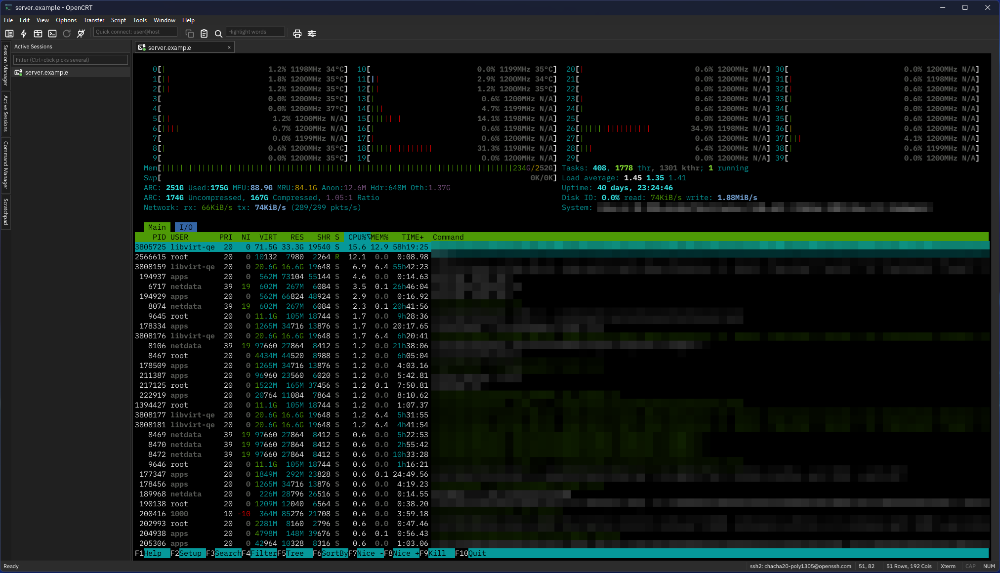

# OpenCRT

A tabbed terminal client for Windows, macOS and Linux, modelled on the look and
workflow of SecureCRT and written from scratch in Rust.



## A clean-room implementation
OpenCRT is an independent project. It is not affiliated with, endorsed by or
derived from VanDyke Software or its SecureCRT product. No SecureCRT source
code, binaries, decompiled or disassembled code, or other copyrighted material
was used to build it. OpenCRT was written from the ground up, with feature
parity as the goal: SecureCRT's features and behaviour were learned only from
its public documentation and from using the product, and every line of
OpenCRT is original. SecureCRT is a trademark of VanDyke Software, Inc.

## Download
Installers for each release are on the
[Releases](https://github.com/KimP0ssible-no/OpenCRT/releases) page (Windows
files are signed as the [Code signing policy](#code-signing-policy) describes):

| Platform | Package |
| --- | --- |
| Windows 10/11 (x64) | `opencrt-<version>-x64-setup.exe`, or the `.msi` for unattended and Group Policy installs |
| macOS (Apple silicon and Intel) | `OpenCRT.dmg` |
| Debian / Ubuntu | `opencrt_<version>-1_amd64.deb` |
| RHEL / Rocky / Alma / Fedora / SUSE | `opencrt-<version>-1.x86_64.rpm` |
| Arch Linux | `opencrt-<version>-1-x86_64.pkg.tar.zst` |

The Linux packages need nothing beyond glibc 2.28 (RHEL 8, Debian 10, Ubuntu
20.04 and newer). `SHA256SUMS` lists the checksum of every file.

### Linux package repositories
On Linux, add the signed OpenCRT repository for your distribution once, and
OpenCRT then updates with the rest of the system (a downloaded package installs
the same way but does not update). The setup for each distribution is at
**[kimp0ssible-no.github.io/OpenCRT](https://kimp0ssible-no.github.io/OpenCRT/)**;
the packages are signed with key `4CDBBCAD19D8BFC8FB62281A3576977C76DF7C33`.

Debian, Ubuntu:
```
sudo install -d /etc/apt/keyrings
curl -fsSL https://kimp0ssible-no.github.io/OpenCRT/opencrt.asc | sudo tee /etc/apt/keyrings/opencrt.asc > /dev/null
echo "deb [signed-by=/etc/apt/keyrings/opencrt.asc] https://kimp0ssible-no.github.io/OpenCRT/apt stable main" | sudo tee /etc/apt/sources.list.d/opencrt.list
sudo apt update && sudo apt install opencrt
```

Fedora, RHEL, Rocky, Alma:
```
sudo curl -fsSL -o /etc/yum.repos.d/opencrt.repo https://kimp0ssible-no.github.io/OpenCRT/rpm/opencrt.repo
sudo dnf install opencrt
```

openSUSE:
```
sudo zypper addrepo https://kimp0ssible-no.github.io/OpenCRT/rpm/opencrt.repo
sudo zypper install opencrt
```

Arch Linux:
```
curl -fsSL https://kimp0ssible-no.github.io/OpenCRT/opencrt.asc | sudo pacman-key --add -
sudo pacman-key --lsign-key 4CDBBCAD19D8BFC8FB62281A3576977C76DF7C33
printf '\n[opencrt]\nServer = https://kimp0ssible-no.github.io/OpenCRT/arch\n' | sudo tee -a /etc/pacman.conf
sudo pacman -Syu opencrt
```

### Verifying a download
`SHA256SUMS` is signed with the OpenCRT release key
([`packaging/minisign.pub`](packaging/minisign.pub)), and every file has a
GitHub build attestation tying it to the workflow run that built it:

```
minisign -Vm SHA256SUMS -p minisign.pub       # the list is genuine
sha256sum -c --ignore-missing SHA256SUMS      # the files match it
gh attestation verify <file> --repo KimP0ssible-no/OpenCRT
```

### New versions
Once a day at start-up OpenCRT asks GitHub which release is the newest (one
request to `github.com/KimP0ssible-no/OpenCRT/releases/latest`, nothing about
you or your sessions is sent) and says so in the status bar when there is a
newer one. Help > Check for Updates asks at any time; turn the daily check off
in Options > Global Options > General.

## Features
- **Protocols**: SSH2 (password, keyboard-interactive, public key incl. PuTTY
  PPK, with passphrase prompts, and SSH agent keys — Pageant or the OpenSSH
  agent on Windows, `SSH_AUTH_SOCK` elsewhere — when no key file is set),
  Telnet, RLogin, raw TCP, serial (COM / tty, modem dialling, VM consoles),
  local shell, and RDP (remote desktop
  in a tab that follows the tab's size, keyboard and mouse, clipboard text
  both ways; NLA with user name and password).
- **Security**: host keys checked against OpenCRT's own `known_hosts`; unknown
  keys are confirmed by the user, changed keys block the connection; saved keys
  can be reviewed and removed in Tools > Host Keys. RDP server certificates
  are checked the same way (`rdp_known_certs`) before any password is sent.
- **Terminal**: xterm emulation (256 colours, truecolour, mouse reporting,
  bracketed paste), scrollback with Find, selection and copy (optionally copy
  on select, paste on right- or middle-click, ask before multi-line pastes),
  ten colour schemes (OpenCRT Dark by default), IBM Plex Mono built in or a
  system font, cursor shape, light and dark window themes that follow the
  system, CJK text, bell as flash or sound, plain-text session
  logging with optional timestamps and dated file names that roll over at
  midnight (per session or File > Log Session), Send
  Break for serial and Telnet, per-session terminal type, Latin-1 encoding
  and Backspace as ^H, function-key mapping, full screen and always on top.
- **Sessions**: Session Manager with folders (rename, Connect All), filter
  (Enter connects) and duplicate; Session Options incl. a tab colour per
  session; a Default Session that new sessions, Quick Connect and the
  connect bar start from; connect bar (`user@host`); tabs with
  reconnect/clone/move (an SSH2 clone or SFTP tab reuses the tab's
  connection, no second login); automatic reconnect; reopening last time's
  sessions; SSH keepalive and per-session anti-idle; Global Options, Button
  Bar, Command Manager (with folders), Command Window, keyword
  highlighting, Edit > Send Input to All Tabs; import from `~/.ssh/config`,
  export/import of sessions.
- **Automation**: [Rhai](https://rhai.rs) scripts (`.rhai`, see Scripting
  below) and simple `wait` / `send` / `sleep` / `timeout` scripts, run from
  Script > Run or as a session's logon script; Script > Start Recording writes
  a Rhai script from what you type (passwords are asked for when it runs).
- **Keys**: Tools > Create Public Key makes an Ed25519 key pair.
- **File transfer**: SFTP tab (`sftp>` prompt with get/put/ls/cd, wildcards and
  progress); Zmodem downloads start when the host runs `sz` (saved to
  Downloads or the folder set in Global Options), uploads via Transfer >
  Zmodem Upload or when the host runs `rz`; Xmodem and Ymodem send and
  receive; drop a file on a tab to upload it; a built-in TFTP server for
  network devices (Global Options > File Transfer).
- **SSH port forwarding**: local, remote and dynamic (SOCKS4/5); jump hosts
  (connect through a gateway, set per session); SOCKS5 or HTTP proxies (SSH2,
  Telnet, raw); agent and X11 forwarding; optional compression;
  legacy algorithms for old devices.

## Keyboard
| Keys | Action |
| --- | --- |
| Ctrl+C / Ctrl+V | Copy (when text is selected, else ^C to the host) / paste |
| Ctrl+Insert / Shift+Insert | Copy / paste |
| Shift+PgUp / Shift+PgDn | Scroll back / forward |
| Ctrl+Tab / Ctrl+Shift+Tab | Next / previous tab |
| Alt+1 … Alt+9 | Go to tab 1 … 9 (Command+n on macOS) |
| Alt+key | Sent as Esc+key (Meta), e.g. Alt+B / Alt+F in shells |
| Alt+Enter | Full screen on / off |
| Ctrl+click a web address | Open it in the browser |
| Ctrl+mouse wheel | Larger / smaller font |
| Session Manager: Up / Down, Enter, Delete | Select, connect (or open a folder), delete |
| Session Manager filter: Enter | Connect the selected (or first) session |
| F1 … F12 (with Ctrl/Alt/Shift) | Your text, if mapped in Global Options > Keyboard |
| Ctrl+C or Esc during a transfer | Cancel it |

## Command-line tools
`ocrt` (installed beside OpenCRT) uses OpenCRT's known host keys and SSH code:

```
ocrt ssh me@router1                 # log in (host keys and passwords are asked for on the terminal)
ocrt ssh -p 2222 me@web1 uptime     # run a command
ocrt sftp me@web1                   # interactive SFTP (type help); -b file runs a batch, stopping at the first error
ocrt cp me@web1:/var/log/syslog .   # copy a file either way
ocrt keygen -t ed25519              # create ~/.ssh/id_ed25519 and .pub
ocrt pka me@web1                    # add your public key to the host's authorized_keys
```

## Scripting
Script > Run (or a session's logon script) runs a `.rhai` file as a
[Rhai](https://rhai.rs) script against the active tab; Script > Cancel stops it.
Rhai strings take the usual escapes, so `"\r"` is Enter.

| Function | What it does |
| --- | --- |
| `send(text)` | Send text to the session |
| `wait_for(text)`, `wait_for(text, secs)` | Wait until the host prints `text`; false on timeout |
| `wait_for_any([a, b, ...], secs)` | Index of the first text seen, -1 on timeout |
| `read_until(text, secs)` | The output before `text` (empty on timeout) |
| `sleep(ms)` | Pause |
| `screen()` | The visible screen as text |
| `message(text)` | Show a message and wait for OK |
| `prompt(text)`, `prompt(text, default)`, `password(text)` | Ask for a line of text |
| `status(text)`, `print(text)` | Show text in the status bar |
| `connect(session)` | Open a saved session (name or folder/name) in a new tab and continue there; true once connected |
| `disconnect()` | Disconnect the session |
| `clipboard()`, `set_clipboard(text)` | Read or set the clipboard |
| `upload(protocol, file)` | Send a file by `"zmodem"` (call before sending `rz`), `"xmodem"`, `"ymodem"` or `"kermit"` |
| `download(protocol)`, `download("xmodem", file)` | Receive into the download folder (Zmodem starts by itself when the host runs `sz`) |
| `wait_transfer(secs)` | Wait for the transfer to end; true if it succeeded (0 secs waits for ever) |
| `ARGS` | The script's arguments |

```
if wait_for("login:", 10) { send("admin\r"); }
wait_for("Password:");
send(password("Password for admin") + "\r");
wait_for("$ ");
send("uptime\r");
upload("zmodem", "C:/configs/router.cfg");
send("rz\r");
if !wait_transfer(60) { message("Upload failed"); }
```

In an SFTP tab, `send("put file\r")` and `send("get file\r")` transfer files.

## Build and run
Requires Rust (stable) and, on Windows, the MSVC build tools. On Linux, a C
compiler and the fontconfig headers (Debian/Ubuntu: `build-essential
libfontconfig-dev`; Fedora/RHEL: `gcc fontconfig-devel`).

```
cargo run --release
cargo run --release -- /SSH2 /L user /P 22 host     # connect on start
cargo run --release -- /TELNET router                # also /RAW, /RLOGIN, /SERIAL COM3 /BAUD 9600, /LOCAL
cargo run --release -- /S "Prod/web1"                # open a saved session (path or name)
cargo run --release -- /F E:\OpenCRT                 # keep all settings in this folder (portable)
cargo run --release -- /RDP /L "DOMAIN\user" winhost  # remote desktop (needs the helper below)
cargo run --release -- ssh://me@host:2222            # also sftp:// and telnet:// links; /I keyfile
cargo run --release -- /T /LOG web1.log /S web1      # new tab in the running window, logged to a file
```

RDP runs in a separate helper program, `opencrt-rdp`, which must sit next to
`opencrt`. It is its own Cargo workspace; build it into the same folder with

```
cargo build --release --manifest-path crates/opencrt-rdp/Cargo.toml --target-dir target
```

Settings live in the per-user config folder (`%APPDATA%\OpenCRT`,
`~/Library/Application Support/OpenCRT`, or `$XDG_CONFIG_HOME/opencrt`):
`sessions.toml`, `options.toml` and `known_hosts`. Passwords are never saved.
If OpenCRT ever stops unexpectedly, `crash.log` in the same folder records why.

## Development
- `cargo test` — unit tests plus end-to-end tests against in-process SSH, SFTP
  and Telnet servers.
- `cargo run --example dev_server` — a local SSH server (127.0.0.1:2222, any
  password) for trying the UI: shell commands `lines n`, `sz`/`rz`/`sx`/`sb`,
  `exit`, and SFTP tabs against an in-memory `/home`. Start OpenCRT with
  `/F <scratch folder>` to try things without touching your own settings.
- RDP helper: `cargo test --manifest-path crates/opencrt-rdp/Cargo.toml
  --target-dir target` (end-to-end against an in-process RDP server), and
  `cargo run --manifest-path crates/opencrt-rdp/Cargo.toml --target-dir target
  --example dev_rdp_server` (127.0.0.1:3390, user and password `demo`; it
  puts "copied on the server" on your clipboard when you connect).
- Docs: `docs/architecture.md` (stack and layout), `docs/packaging.md`
  (installers and releases).

## Code signing policy
Free code signing provided by [SignPath.io](https://about.signpath.io),
certificate by [SignPath Foundation](https://signpath.org). (Applied for in
October 2026; until it is granted, Windows releases are unsigned.)

Only Windows files built from this repository's source by its GitHub Actions
release workflow are signed, and every signing request is approved by hand.

| Role | Members |
| --- | --- |
| Committers and reviewers | [Kim Attree](https://github.com/KimP0ssible-no) |
| Approvers | [Kim Attree](https://github.com/KimP0ssible-no) |

Pull requests from anyone else are reviewed by a committer before they are
merged.

### Privacy policy
This program will not transfer any information to other networked systems
unless specifically requested by the user or the person installing or
operating it. The one exception is the daily update check described under
[New versions](#new-versions): a single request to GitHub that sends nothing
about you or your sessions, and that Options > Global Options > General turns
off. GitHub handles that request under the
[GitHub General Privacy Statement](https://docs.github.com/en/site-policy/privacy-policies/github-general-privacy-statement).

## Licence
Copyright 2026 Kim Attree. Licensed under the Apache License, Version 2.0
(`LICENSE`); redistributions must keep the `NOTICE` file. The user interface
uses Slint under GPL-3.0-only (`SLINT-LICENSE.md`), so the `opencrt` program as
built and shipped is GPL-3.0-only; the RDP helper `opencrt-rdp` does not use
Slint and stays Apache-2.0.
