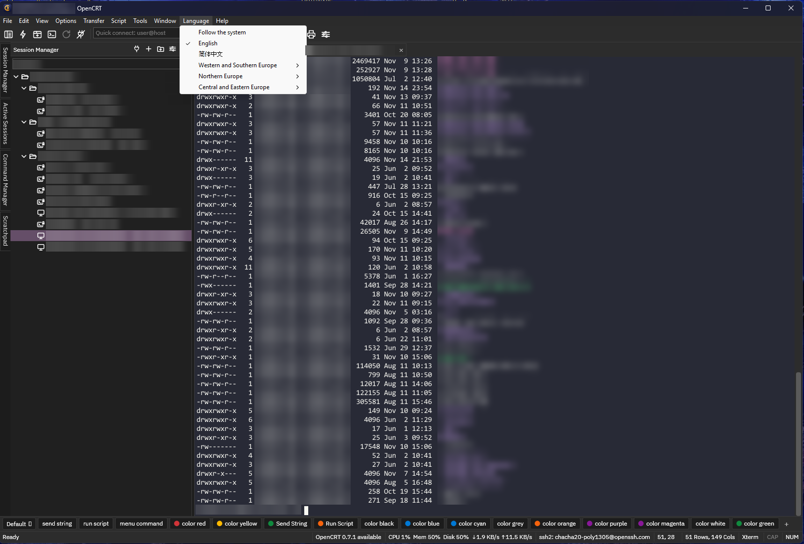
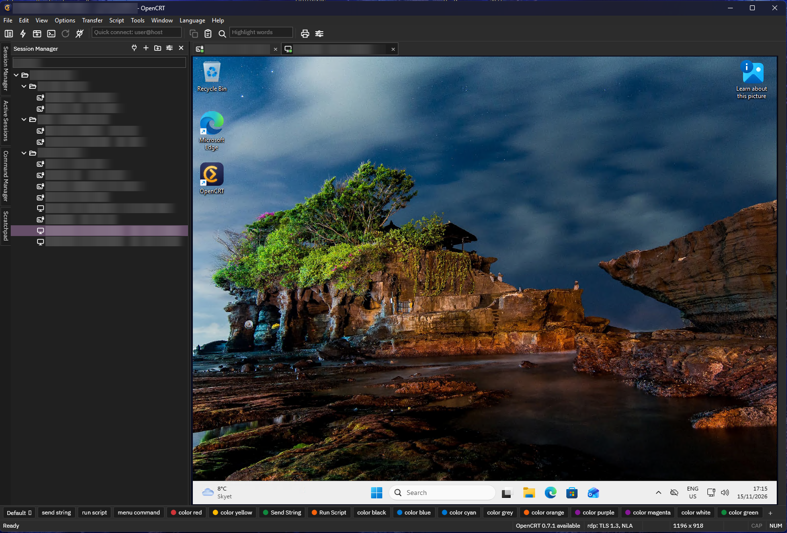

# OpenCRT

A tabbed terminal client for Windows, macOS and Linux, modelled on the look and
workflow of SecureCRT and written from scratch in Rust.





## Why OpenCRT
### Every connection in one window
SSH2, SFTP, Telnet, RLogin, raw TCP, serial consoles, local shells, Remote
Desktop and VNC all open as tabs in the same window. Jump hosts, port
forwarding, SOCKS and HTTP proxies, X11 and agent forwarding, Zmodem, Xmodem,
Ymodem and a TFTP server are built in. There is nothing extra to install and
no plug-in to find.
- SSH2 logs in with a password, keyboard-interactive or a public key (PuTTY
  PPK files too), and asks for passphrases. When no key file is set, it uses
  your SSH agent: Pageant or the OpenSSH agent on Windows, `SSH_AUTH_SOCK`
  elsewhere.
- Serial ports (COM or tty) come with modem dialling and work for VM
  consoles.
- On Windows, the toolbar's local-shell button opens PowerShell, Command
  Prompt or a WSL distribution.

### Remote desktops in a tab
Remote Desktop and VNC desktops open in a tab next to your terminals:
- Remote Desktop connects to Windows, xrdp and GNOME Remote Desktop, with
  NLA (user name and password), the console session (like `mstsc /admin`),
  keyboard and mouse, clipboard text both ways, and a desktop that follows
  the size of the tab.
- VNC connects to RFB 3.3 to 3.8 servers such as TightVNC, a QEMU console or
  a Mac with its own user account. It logs in with no password, a VNC
  password, TightVNC's login or VeNCrypt TLS. Tight with JPEG quality suits
  slow links, and ZRLE is there too. The desktop is shown whole or scaled to
  the tab.
- OpenCRT checks the server's certificate before it sends a password (for
  VNC, over VeNCrypt). Set a jump host to tunnel either protocol over SSH.

### A terminal that does it all
Everything you expect from xterm, and the tools around it:
- xterm emulation with 256 colours, truecolour, mouse reporting and bracketed
  paste, and CJK text.
- Scrollback with Find. Copy on select, paste on a right or middle click, and
  a question before a multi-line paste, each if you want it.
- Twenty colour schemes: OpenCRT Dark by default, Solarized, Gruvbox,
  Dracula, Nord, Tomorrow, One Dark, Catppuccin, Tango, Tokyo Night and more.
- IBM Plex Mono built in, or any system font, and your choice of cursor
  shape.
- Light and dark window themes that follow the system, and an interface font
  size for menus, tabs and dialogs (on Linux it starts at the desktop's).
- The bell as a flash or a sound.
- Plain-text session logs with optional timestamps and dated file names that
  roll over at midnight, per session or with File > Log Session. A raw log
  beside it keeps the bytes as received (`.raw`, for emulation debugging).
- Recordings in asciicast v2 (File > Record Session), for `asciinema play`
  and web players.
- Send Break for serial and Telnet, a terminal type per session, Latin-1
  encoding, Backspace as ^H and function-key mapping.
- Full screen and always on top.

### Sessions your way
Every device you look after stays one click away:
- The Session Manager has folders (rename, Connect All, drag and drop), a
  filter where Enter connects, and duplicate.
- Session Options include a tab colour per session. A Default Session is the
  starting point for new sessions, Quick Connect and the connect bar
  (`user@host`).
- Tabs reconnect, clone and move. An SSH2 clone or an SFTP tab reuses the
  tab's connection, so there is no second login.
- Automatic reconnect, last time's sessions reopened at start-up, SSH
  keepalive and anti-idle per session.
- Global Options, the Button Bar, the Command Manager (with folders) and the
  Command Window.
- Keyword highlighting in any colour on the background or the text, in bold,
  for whole words, whole lines or regular expressions.
- Edit > Send Input to All Tabs.
- Sessions export to a file and import back. Tools > Import Sessions also
  reads `~/.ssh/config` and Remote Desktop Connection `.rdp` files (as RDP
  sessions, several at once).

### Files in and out
Every way to move a file, in the same window:
- An SFTP tab with an `sftp>` prompt: get, put, ls and cd, with wildcards
  and progress.
- An SFTP GUI tab with the local and remote file lists side by side and a
  queue of waiting, failed and finished transfers. Folders copy whole.
- Zmodem downloads start when the host runs `sz`, into Downloads or the
  folder set in Global Options. Uploads start from Transfer > Zmodem Upload
  or when the host runs `rz`.
- Xmodem and Ymodem send and receive.
- Drop a file on a tab to upload it.
- A built-in TFTP server for network devices (Global Options > File
  Transfer).

### Tunnels and proxies
Reach any host, however it is hidden:
- Local, remote and dynamic (SOCKS4/5) SSH port forwarding.
- Jump hosts: connect through a gateway, set per session.
- SOCKS5 or HTTP proxies for SSH2, Telnet and raw connections.
- Agent and X11 forwarding, and optional compression.
- Legacy algorithms for old devices, per session or for every host (Global
  Options > Connection).

### Bring your SecureCRT setup with you
OpenCRT reads what you already have:
- Tools > Import Sessions takes your SecureCRT sessions with their folders,
  button bar and keyword list. The button bars keep their send and
  run-script buttons, and the keyword lists keep their exact colours and
  regular expressions. Older Keyword List V2 files work too.
- SecureCRT Python 3 scripts run unchanged, with the `crt` object and its
  constants.
- Rhai scripts use the same `crt` names, so a script ports in minutes.
- The command line is the one you know: `/SSH2 /L user /P 22 host`, `/S`,
  `/T`, `/F`, `/LOG`, `/TELNET`, `/SERIAL COM3 /BAUD 9600`.

### Scripts that do the typing
Automate the boring parts:
- Run [Rhai](https://rhai.rs) scripts (`.rhai`, see Scripting below),
  SecureCRT Python scripts (`.py`) and simple `wait` / `send` / `sleep` /
  `timeout` scripts from Script > Run or as a session's logon script.
- Script > Start Recording writes a Rhai script from what you type.
  Passwords are asked for when it runs.
- Scripts in the `scripts` folder of the settings folder (where Script > Run
  starts) go wherever Settings Sync takes your settings. A logon script in
  there is saved by its name, so every computer finds it.
- Every script runs locked in its own process. Before a script reads files
  outside its own folders, starts a program or uses the network, OpenCRT
  asks you.

### Your settings on every computer
Settings Sync keeps your sessions, options, host keys and scripts in a
private git repository on GitHub, GitLab or your own server, over HTTPS with
a token or SSH with a key or agent. Change a session on your Windows laptop
and it is on your Linux desktop and your Mac at the next sync. OpenCRT merges
changes by content, so two computers can make changes at the same time.
Passwords and machine-specific settings stay on each computer, and passwords
travel encrypted only when you set a master password. Settings Sync uses the
installed `git`: the Linux packages depend on it, and on Windows OpenCRT
offers to download Git for Windows.

Settings that depend on the computer are kept per platform (Windows, Linux,
macOS): a serial session's port, a local session's command, the pre-connect
command, the folder shared with a remote desktop, and key, certificate and log
files outside your home folder. Set them once on each platform, and each keeps
its own. Files inside your home folder are saved as `~/...`. A path is shared
by every platform until a platform sets a different one, so keep key files at
the same place in your home folder on every computer, for example in `~/.ssh`,
and one path works everywhere. Settings Sync does not copy key files. If two computers
on the same platform keep a key in different places, leave the session's key
empty and set it per computer in Global Options > Connection > Default SSH2 key
file, or load it into your SSH agent.

### In your language
The interface speaks 30 languages: English, Simplified and Traditional
Chinese, Japanese, Korean and 25 European languages. OpenCRT follows the
system language, and the Language menu chooses another.

### Safe by design
OpenCRT is written in Rust from the first line, and it guards your logins:
- Host keys are checked against OpenCRT's own `known_hosts`. You confirm an
  unknown key (or, if Global Options > Connection says so, it is saved
  without a question, like OpenSSH's `accept-new`). A changed key blocks the
  connection. Tools > Host Keys shows the saved keys and removes them.
- Remote Desktop server certificates are checked the same way
  (`rdp_known_certs`) before any password is sent.
- Saved passwords and key passphrases live in the system keychain. With a
  master password (Tools > Master Password) they live in the settings folder
  instead, encrypted with Argon2id and AES-256-GCM, unlocked once per run
  when first needed, and carried by Settings Sync.
- Tools > Create Public Key makes an Ed25519 key pair.
- The Remote Desktop client runs in a separate helper process, so a
  misbehaving server cannot take down your terminal tabs.

### A supply chain you can check
- Release files are built only by the project's GitHub Actions workflow from
  a tagged commit, and the maintainer approves every release by hand.
- Windows programs and installers are signed with a Certum code signing
  certificate.
- `SHA256SUMS` is signed with minisign, and every file has a GitHub build
  provenance attestation (`gh attestation verify`).
- The apt, dnf, zypper and pacman repositories are signed with GPG.
- Releases are immutable: a published version cannot be changed afterwards.
- The built-in updater installs a download only if its checksum is in a
  `SHA256SUMS` that carries the release key's signature.
- Every pull request passes cargo-deny (licences, banned crates, crate
  sources), CodeQL for Rust, Python and the workflows, and a fuzzing run. A
  release tag also fails on any known RustSec advisory.
- A daily job checks every dependency against the RustSec database and fuzzes
  the terminal parser, Telnet, Zmodem, Xmodem and Ymodem, Kermit and the
  Remote Desktop graphics decoder for 20 minutes each. A weekly job runs the
  Remote Desktop decoder's tests under Miri.
- Dependabot watches the dependencies, and you can report a vulnerability
  privately (see `SECURITY.md`).

### Light on memory
OpenCRT uses less memory than SecureCRT, and with a Remote Desktop session
open it uses about one quarter:

| Scenario | OpenCRT | SecureCRT |
| --- | --- | --- |
| Started, no tabs (Linux) | 48 MB | 63 MB |
| One SSH tab (Linux) | 57 MB | 65 MB |
| Ten SSH tabs (Linux) | 64 MB | 72 MB |
| Four SSH tabs with a full scrollback (Linux) | 76 MB | 83 MB |
| One Remote Desktop tab (Windows 11) | 74.6 MB | 300.5 MB |

Scrollback lines are stored only up to their last character, and fonts for
Chinese, Japanese, Korean and symbols are read only as their characters
appear. On Linux, both programs connected to the same local SSH server, with
10,000 lines of scrollback each, and the figures are PSS (each process's share
of memory, from `/proc/<pid>/smaps_rollup`) against SecureCRT 9.7.2. On
Windows, the figures come from Task Manager against SecureCRT 9.7, and the
OpenCRT figure adds the window (39.1 MB) and its Remote Desktop helper
(35.5 MB).

### Runs where you work
Windows 10 and 11 (setup, MSI for Group Policy, or a portable zip for a USB
stick), macOS on Apple silicon and Intel, Debian and Ubuntu, RHEL, Rocky,
Alma, Fedora and SUSE, and Arch Linux, on x86_64 and on ARM64 (an AppImage
for any other Linux). OpenCRT is free and open source.

## A clean-room implementation
OpenCRT is an independent project. It is not affiliated with, endorsed by or
derived from VanDyke Software or its SecureCRT product. No SecureCRT source
code, binaries, decompiled or disassembled code, or other copyrighted material
was used to build it. OpenCRT was written from the ground up, with feature
parity as the goal: SecureCRT's features and behaviour were learned only from
its public documentation and from using the product, and every line of
OpenCRT is original. SecureCRT is a trademark of VanDyke Software, Inc.

## Download
Installers for each release are on the
[Releases](https://github.com/KimP0ssible-no/OpenCRT/releases) page (Windows
files are signed as the [Code signing policy](#code-signing-policy) describes):

| Platform | Package |
| --- | --- |
| Windows 10/11 (x64) | `opencrt-<version>-x64-setup.exe`, or the `.msi` for unattended and Group Policy installs |
| Windows, portable (x64) | `opencrt-<version>-x64-portable.zip`: unpack anywhere (a USB stick), nothing installed |
| macOS (Apple silicon and Intel) | `OpenCRT.dmg` |
| Debian / Ubuntu | `opencrt_<version>-1_amd64.deb`, ARM64: `opencrt_<version>-1_arm64.deb` |
| RHEL / Rocky / Alma / Fedora / SUSE | `opencrt-<version>-1.x86_64.rpm`, ARM64: `opencrt-<version>-1.aarch64.rpm` |
| Arch Linux (x86_64) | `opencrt-<version>-1-x86_64.pkg.tar.zst` |
| Other Linux | `OpenCRT-<version>-x86_64.AppImage`, ARM64: `OpenCRT-<version>-aarch64.AppImage` |

The Linux packages need glibc 2.28 (RHEL 8, Debian 10, Ubuntu 20.04 and
newer), fontconfig and the C++ runtime, which every desktop system has. The
AppImage needs the same and nothing installed: make it executable
(`chmod +x`) and run it. It does not update itself: download the new one from
the release page. `SHA256SUMS` lists the checksum of every file.

The portable zip carries a `portable.txt` beside `opencrt.exe`: while it is
there, OpenCRT keeps its settings, sessions and host keys in a `settings`
folder next to the program and nothing in the Windows profile. Saved passwords
are kept only under a master password (Tools > Master Password), encrypted in
that folder. The same file works next to any OpenCRT program, on any system.

### Mac users: install how-to
OpenCRT is not notarised by Apple yet. Install it from Terminal
(Applications > Utilities > Terminal) with:

```sh
curl -fsSL https://raw.githubusercontent.com/KimP0ssible-no/OpenCRT/main/packaging/macos/install.sh | sh
```

[The script](packaging/macos/install.sh) downloads `OpenCRT.dmg` from the
latest release, checks it against `SHA256SUMS`, puts OpenCRT in Applications
(in your own `~/Applications` if you cannot write to the shared one) and starts
it. A file Terminal downloads is not flagged as downloaded from the internet,
so macOS opens OpenCRT without asking.

**Upgrades** need nothing more: OpenCRT looks for a new version at start-up and
once a day (Help > Check for Updates to look now), and **Update
Now** downloads it, checks the release signature, replaces the app and restarts
it. Running the install command again also upgrades (quit OpenCRT first).

**From the disk image instead**: open `OpenCRT.dmg` and drag OpenCRT onto
Applications. The first double-click ends with "OpenCRT Not Opened": click
**Done**, then in **System Settings > Privacy & Security** click **Open
Anyway**, confirm, and enter your password or use Touch ID (right-click > Open
no longer does this on macOS 15 and later).

**Local network**: the first connection to a host on your local network makes
macOS ask whether OpenCRT may use it: click **Allow**. If you did not,
connections fail with "No route to host"; turn OpenCRT on in **System Settings
> Privacy & Security > Local Network**.

### Linux package repositories
On Linux, add the signed OpenCRT repository for your distribution once, and
OpenCRT then updates with the rest of the system (a downloaded package installs
the same way but does not update). The setup for each distribution is at
**[kimp0ssible-no.github.io/OpenCRT](https://kimp0ssible-no.github.io/OpenCRT/)**;
the packages are signed with key `4CDBBCAD19D8BFC8FB62281A3576977C76DF7C33`.

Debian, Ubuntu:
```
sudo install -d /etc/apt/keyrings
curl -fsSL https://kimp0ssible-no.github.io/OpenCRT/opencrt.asc | sudo tee /etc/apt/keyrings/opencrt.asc > /dev/null
echo "deb [signed-by=/etc/apt/keyrings/opencrt.asc] https://kimp0ssible-no.github.io/OpenCRT/apt stable main" | sudo tee /etc/apt/sources.list.d/opencrt.list
sudo apt update && sudo apt install opencrt
```

Fedora, RHEL, Rocky, Alma:
```
sudo curl -fsSL -o /etc/yum.repos.d/opencrt.repo https://kimp0ssible-no.github.io/OpenCRT/rpm/opencrt.repo
sudo dnf install opencrt
```

openSUSE:
```
sudo zypper addrepo https://kimp0ssible-no.github.io/OpenCRT/rpm/opencrt.repo
sudo zypper install opencrt
```

Arch Linux:
```
curl -fsSL https://kimp0ssible-no.github.io/OpenCRT/opencrt.asc | sudo pacman-key --add -
sudo pacman-key --lsign-key 4CDBBCAD19D8BFC8FB62281A3576977C76DF7C33
printf '\n[opencrt]\nServer = https://kimp0ssible-no.github.io/OpenCRT/arch\n' | sudo tee -a /etc/pacman.conf
sudo pacman -Syu opencrt
```

### Verifying a download
`SHA256SUMS` is signed with the OpenCRT release key
([`packaging/minisign.pub`](packaging/minisign.pub)), and every file has a
GitHub build attestation tying it to the workflow run that built it:

```
minisign -Vm SHA256SUMS -p minisign.pub       # the list is genuine
sha256sum -c --ignore-missing SHA256SUMS      # the files match it
gh attestation verify <file> --repo KimP0ssible-no/OpenCRT
```

### New versions
At start-up, and once a day while it runs, OpenCRT asks GitHub which release
is the newest (one request to `github.com/KimP0ssible-no/OpenCRT/releases/latest`,
nothing about you or your sessions is sent) and says so in the status bar when
there is a newer one. Help > Check for Updates asks at any time; turn the
automatic check off in Options > Global Options > General.

Distribution packagers can build OpenCRT without the update check and Update
Now. Build with `--no-default-features`, as [Build and run](#build-and-run)
shows. That build never contacts GitHub and has no update menu item or button.

## Languages
OpenCRT's interface is available in English, Simplified and Traditional
Chinese, Japanese, Korean and 25 European languages: Bulgarian, Croatian, Czech,
Danish, Dutch, Estonian,
Finnish, French, German, Greek, Hungarian, Irish, Italian, Latvian,
Lithuanian, Maltese, Norwegian Bokmål, Polish, Portuguese, Romanian, Slovak,
Slovenian, Spanish, Swedish and Ukrainian. OpenCRT follows the system language;
the Language menu chooses another.

The translations are machine translations. If a text reads wrong in your
language, open an issue or a pull request with the correction:
`crates/opencrt/lang/README.md` explains the files.

## Keyboard
| Keys | Action |
| --- | --- |
| Ctrl+C / Ctrl+V | Copy (when text is selected, else ^C to the host) / paste |
| Ctrl+Insert / Shift+Insert | Copy / paste |
| Shift+PgUp / Shift+PgDn | Scroll back / forward |
| Ctrl+Tab / Ctrl+Shift+Tab | Next / previous tab |
| Ctrl+Shift+T (Command+O on macOS) | Quick Open: find a saved session or type a host |
| macOS: Command+K / Command+T | Quick Connect / Connect in Tab |
| macOS: Command+E | Open a saved session (the Session Manager's filter) |
| macOS: Command+L | Connect a local shell |
| Alt+1 … Alt+9 | Go to tab 1 … 9 (Command+n on macOS) |
| Alt+key | Sent as Esc+key (Meta), e.g. Alt+B / Alt+F in shells |
| Alt+Enter | Full screen on / off |
| Ctrl+click a web address or an OSC 8 link | Open it in the browser (links are underlined; http and https only) |
| Ctrl+mouse wheel | Larger / smaller font |
| Session Manager: Up / Down, Enter, Delete | Select, connect (or open a folder), delete |
| Session Manager filter: Enter | Connect the selected (or first) session |
| Dialog lists: Up / Down, Home / End | Move through colour schemes and option pages |
| F1 … F12 (with Ctrl/Alt/Shift) | Your text, if mapped in Global Options > Keyboard |
| Ctrl+C or Esc during a transfer | Cancel it |

Help > Keyboard Shortcuts shows the main ones in OpenCRT. F1 stays with the
host; map it with `F1 = menu: shortcuts` to open that list instead.
`Alt+R = menu: focus-connect-bar` puts the keyboard in the toolbar's quick
connect box, as Alt+R does in SecureCRT (Alt+R stays with the host unless mapped).
On Windows and Linux, the macOS Command keys' actions can be mapped too, e.g.
`F2 = menu: open-session` or `F3 = menu: local-shell` (Ctrl+K and Ctrl+L stay
with the shell).

## Command-line tools
`ocrt` (installed beside OpenCRT) uses OpenCRT's known host keys and SSH code:

```
ocrt ssh me@router1                 # log in (host keys and passwords are asked for on the terminal)
ocrt ssh -p 2222 me@web1 uptime     # run a command
ocrt sftp me@web1                   # interactive SFTP (type help); -b file runs a batch, stopping at the first error
ocrt cp me@web1:/var/log/syslog .   # copy a file either way
ocrt keygen -t ed25519              # create ~/.ssh/id_ed25519 and .pub
ocrt pka me@web1                    # add your public key to the host's authorized_keys
```

## Scripting
Script > Run (or a session's logon script) runs a `.rhai` file as a
[Rhai](https://rhai.rs) script against the active tab; Script > Cancel stops it.
Rhai strings take the usual escapes, so `"\r"` is Enter.

| Function | What it does |
| --- | --- |
| `send(text)` | Send text to the session |
| `wait_for(text)`, `wait_for(text, secs)` | Wait until the host prints `text`; false on timeout |
| `wait_for_any([a, b, ...], secs)` | Index of the first text seen, -1 on timeout |
| `read_until(text, secs)` | The output before `text` (empty on timeout) |
| `sleep(ms)` | Pause |
| `screen()` | The visible screen as text |
| `message(text)` | Show a message and wait for OK |
| `prompt(text)`, `prompt(text, default)`, `password(text)` | Ask for a line of text |
| `status(text)`, `print(text)` | Show text in the status bar |
| `connect(session)` | Open a saved session (name or folder/name) in a new tab and continue there; true once connected |
| `disconnect()` | Disconnect the session |
| `clipboard()`, `set_clipboard(text)` | Read or set the clipboard |
| `upload(protocol, file)` | Send a file by `"zmodem"` (call before sending `rz`), `"xmodem"`, `"ymodem"` or `"kermit"` |
| `download(protocol)`, `download("xmodem", file)` | Receive into the download folder (Zmodem starts by itself when the host runs `sz`) |
| `wait_transfer(secs)` | Wait for the transfer to end; true if it succeeded (0 secs waits for ever) |
| `ARGS` | The script's arguments |
| `read_file(file)`, `read_lines(file)` | A file's text, or its lines as an array |
| `write_file(file, text)`, `append_file(file, text)`, `file_exists(file)` | Write, add to, or check for a file |
| `re_search(pattern, text)`, `re_match(pattern, text)` | The first match and its groups as an array (empty when none); `re_match` only at the start |
| `re_findall(pattern, text)`, `re_split(pattern, text)`, `re_sub(pattern, with, text)` | Every match, the parts between matches, or the text with matches replaced (`$1` is group 1) |
| `strftime(format)`, `unix_time()` | The local time formatted (`"%Y-%m-%d"`), or seconds since 1970 |
| `env(name)` | An environment variable ("" if unset) |
| `path_join(a, b)`, `dir_name(path)`, `base_name(path)` | Build or take apart file paths |
| `fmt(value, spec)` | A value formatted as Python's `format` does: `fmt(3.14159, ".2f")`, `fmt(name, "<20")`, `fmt(n, "05d")` |
| `slice(value, start)`, `slice(value, start, end)` | Part of a string or array, as Python's `value[start:end]` (negative counts from the end) |

Files are found relative to the script's folder, and scripts may only use
files in their own folder, the download folder and the session's log folder.
Patterns are [regular expressions](https://docs.rs/regex/latest/regex/#syntax).

```
if wait_for("login:", 10) { send("admin\r"); }
wait_for("Password:");
send(password("Password for admin") + "\r");
wait_for("$ ");
send("uptime\r");
upload("zmodem", "C:/configs/router.cfg");
send("rz\r");
if !wait_transfer(60) { message("Upload failed"); }
```

In an SFTP tab, `send("put file\r")` and `send("get file\r")` transfer files.

### SecureCRT's `crt` object
Scripts can also use the objects SecureCRT gives its scripts, under the same
names, so scripts written for SecureCRT carry over with few changes:

```
crt.Screen.Synchronous = true;
crt.Screen.Send("show version\r");
if crt.Screen.WaitForString("#", 10) {
    let tab = crt.Session.ConnectInTab("/S Network/edge-rtr1");
    tab.Screen.WaitForString("#", 10);
    if crt.Dialog.MessageBox("Reload edge-rtr1?", "Reload", BUTTON_YESNO) == IDYES {
        tab.Screen.Send("reload\r");
    }
}
```

| Object | Members |
| --- | --- |
| `crt` | `Screen`, `Session`, `Dialog`, `Clipboard`, `FileTransfer`, `Window`, `Arguments`, `ScriptFullName`, `Version`, `Sleep(ms)`, `GetScriptTab()`, `GetActiveTab()`, `GetTab(n)` (from 1), `GetTabCount()`, `GetLastError()` (0 when the last call worked), `GetLastErrorMessage()`, `ClearLastError()`, `OpenSessionConfiguration(session)`, `Quit()` |
| `Screen` | `Send(text)`; `WaitForString(text[, timeout[, ms]])`, `WaitForStrings([a, b, ...][, timeout[, ms]])` (the number of the text seen, from 1; 0 on timeout), `ReadString(text or [a, b, ...][, timeout[, ms]])` (the output before it); `MatchIndex`, `Synchronous`, `IgnoreCase`, `IgnoreEscape` (waits skip escape sequences); `Get(row1, col1, row2, col2)`, `Get2(...)` (rows joined by CR LF), `CurrentRow`, `CurrentColumn`, `Rows`, `Columns`, `Selection` (the selected text), `WaitForCursor([timeout[, ms]])`, `Clear()` |
| `Session` | `Connect(target)` (the script continues in the new tab), `ConnectInTab(target)` (returns the tab), `Disconnect()`, `Connected`, `SetStatusText(text)`, `Config` (the tab's saved session) |
| Tab | `Screen`, `Session`, `Caption`, `Activate()` |
| `Dialog` | `MessageBox(text[, title[, style]])`, `Prompt(text[, title[, default[, password]]])` ("" if cancelled), `FileOpenDialog(title[, button[, file[, filter]]])`, `FileSaveDialog(title[, file[, filter]])` |
| `Clipboard` | `Text` |
| `Window` | `Caption` |
| `FileTransfer` | `DownloadFolder`, `AddToUploadList(file)` (a Zmodem upload of it starts when the host runs `rz`), `ClearUploadList()`, `SendYmodem()`, `SendKermit()` (the upload list's first file), `SendXmodem(file)`, `ReceiveXmodem(name)`, `ReceiveYmodem()`, `ReceiveKermit()` (into the download folder); each waits for the transfer to end |
| Session configuration | `GetOption(name)`, `SetOption(name, value)`, `Save([session])` |
| `Arguments` | `Count`, `GetArg(i)`, `Arguments[i]` |

Timeouts are in seconds (milliseconds when `ms` is true); none or 0 waits for
ever. A connect target is a saved session's name or folder/name, or a command
line such as `/S "Network/core-sw1"` or `/SSH2 /L admin 10.0.0.1`. MessageBox
styles and answers use SecureCRT's constants: `BUTTON_OK`, `BUTTON_CANCEL`
(OK and Cancel), `BUTTON_YESNO`, `BUTTON_YESNOCANCEL`, `BUTTON_RETRYCANCEL`,
`BUTTON_ABORTRETRYIGNORE`, `ICON_INFO`, `ICON_QUESTION`, `ICON_WARN`,
`ICON_STOP`, and `IDOK`, `IDCANCEL`, `IDYES`, `IDNO`, `IDABORT`, `IDRETRY`,
`IDIGNORE`.

As in SecureCRT, a screen that is not `Synchronous` (the default) ignores what
the host printed before the last `Send`; set `Synchronous = true` to wait for
anything not yet matched. Rhai functions cannot see variables set outside
them, so `crt`, the constants and `G`, a map every function shares
(`G.count = 0;` then `G.count += 1;` inside a function), work everywhere.

`OpenSessionConfiguration("Default")` is the Default Session; other names are
saved sessions (folder/name), and `Save("Folder/new")` saves a copy. The
options OpenCRT has are `Hostname`, `Username`, `Port` (`[SSH2] Port`),
`Protocol Name` (`SSH2`, `Telnet`, `Raw`, `Serial`, `Local Shell`, `RDP`,
`RLogin`, `VNC`), `Emulation`, `Description`, `Log Filename V2`,
`Script Filename V2`, `Identity Filename V2`, `Color Scheme`, `Keyword Set`,
`Rows` and `Cols`; setting any other option does nothing.

### Python scripts
Script > Run (or a session's logon script) runs a SecureCRT Python 3 script
(`.py`) as it is: `crt` and the constants are there as in SecureCRT, with the
members above. `print()` shows in the status bar, and an error stops the
script with its line number in the terminal. Python 2 scripts are refused.

Each script runs in its own Python process, so it cannot stall or crash
OpenCRT, and it is gone (with its memory, about 11 MB) when it ends or is
cancelled. On Linux that is the system's `python3`; on Windows and macOS
OpenCRT downloads Python 3.14 (12 to 27 MB, checked against a checksum built
into OpenCRT) the first time you run a Python script. To use your own Python
(say, for packages installed with pip), set it in Global Options > General;
it must be Python 3.8 or newer.

A script runs locked until you trust it: it may use files only in its own
folder, the download folder and the log folder (and read Python's own), and
may not run programs, use the network or load native code. When it tries,
OpenCRT says what it wants and asks: Allow once lets this run go on unlocked,
Always trust this script remembers it until the file changes (in
`trusted_scripts` in the settings folder), and Stop ends it. Settings Sync
shares that list, so a script in the `scripts` folder trusted on one computer
is trusted on the others; anyone who can change your settings repository can
therefore add a trusted script. A locked script may use up to 2 GB of memory, and stopping a script
also ends the programs it started. On Linux a locked script also cannot read
other programs' memory (OpenCRT's passwords) or use the kernel's riskier
calls. The lock stops surprises, not a script written to get round it: run
only scripts you would run outside OpenCRT.

## Build and run
Requires Rust (stable) and, on Windows, the MSVC build tools. On Linux, a C
compiler and the fontconfig headers (Debian/Ubuntu: `build-essential
libfontconfig-dev`; Fedora/RHEL: `gcc fontconfig-devel`).

```
cargo run --release
cargo run --release -- /SSH2 /L user /P 22 host     # connect on start
cargo run --release -- /TELNET router                # also /RAW, /RLOGIN, /SERIAL COM3 /BAUD 9600, /LOCAL
cargo run --release -- /S "Prod/web1"                # open a saved session (path or name)
cargo run --release -- /F E:\OpenCRT                 # keep all settings in this folder (portable)
cargo run --release -- /RDP /L "DOMAIN\user" winhost  # remote desktop (needs the helper below)
cargo run --release -- /VNC /P 5901 pi               # VNC desktop; also vnc://host:port
cargo run --release -- ssh://me@host:2222            # also sftp:// and telnet:// links; /I keyfile
cargo run --release -- /T /LOG web1.log /S web1      # new tab in the running window, logged to a file
cargo build --release -p opencrt --no-default-features  # for distribution packages: no update check or Update Now
```

RDP runs in a separate helper program, `opencrt-rdp`, which must sit next to
`opencrt`. It is its own Cargo workspace; build it into the same folder with

```
cargo build --release --manifest-path crates/opencrt-rdp/Cargo.toml --target-dir target
```

Settings live in the per-user config folder (`%APPDATA%\OpenCRT`,
`~/Library/Application Support/OpenCRT`, or `$XDG_CONFIG_HOME/opencrt`):
`sessions.toml`, `options.toml` and `known_hosts`. Passwords are never saved.
If OpenCRT ever stops unexpectedly, `crash.log` in the same folder records why.

## Development
- `cargo test` — unit tests plus end-to-end tests against in-process SSH, SFTP
  and Telnet servers.
- `cargo run --example dev_server` — a local SSH server (127.0.0.1:2222, any
  password) for trying the UI: shell commands `lines n`, `sz`/`rz`/`sx`/`sb`,
  `exit`, and SFTP tabs against an in-memory `/home`. Start OpenCRT with
  `/F <scratch folder>` to try things without touching your own settings.
- RDP helper: `cargo test --manifest-path crates/opencrt-rdp/Cargo.toml
  --target-dir target` (end-to-end against an in-process RDP server), and
  `cargo run --manifest-path crates/opencrt-rdp/Cargo.toml --target-dir target
  --example dev_rdp_server` (127.0.0.1:3390, user and password `demo`; it
  puts "copied on the server" on your clipboard when you connect).
- Docs: `docs/architecture.md` (stack and layout), `docs/packaging.md`
  (installers and releases).

## Code signing policy
Windows releases are signed with a [Certum](https://www.certum.eu) Open
Source Code Signing certificate issued to the project's maintainer: the
programs, the setup and its uninstaller, and the MSI. The key stays in
Certum's SimplySign cloud. Releases before the first signed one are unsigned.

Only Windows files built from this repository's source by its GitHub Actions
release workflow are signed, and every release that signs them is approved by
hand.

| Role | Members |
| --- | --- |
| Committers and reviewers | [Kim Attree](https://github.com/KimP0ssible-no) |
| Approvers | [Kim Attree](https://github.com/KimP0ssible-no) |

Pull requests from anyone else are reviewed by a committer before they are
merged.

### Privacy policy
This program will not transfer any information to other networked systems
unless specifically requested by the user or the person installing or
operating it. The one exception is the update check described under
[New versions](#new-versions): a single request to GitHub that sends nothing
about you or your sessions, that Options > Global Options > General turns
off, and that builds made with `--no-default-features` leave out. GitHub handles that request under the
[GitHub General Privacy Statement](https://docs.github.com/en/site-policy/privacy-policies/github-general-privacy-statement).

## Licence
Copyright 2026 Kim Attree. Licensed under the Apache License, Version 2.0
(`LICENSE`); redistributions must keep the `NOTICE` file. The user interface
uses Slint under GPL-3.0-only (`SLINT-LICENSE.md`), so the `opencrt` program as
built and shipped is GPL-3.0-only; the RDP helper `opencrt-rdp` does not use
Slint and stays Apache-2.0.
